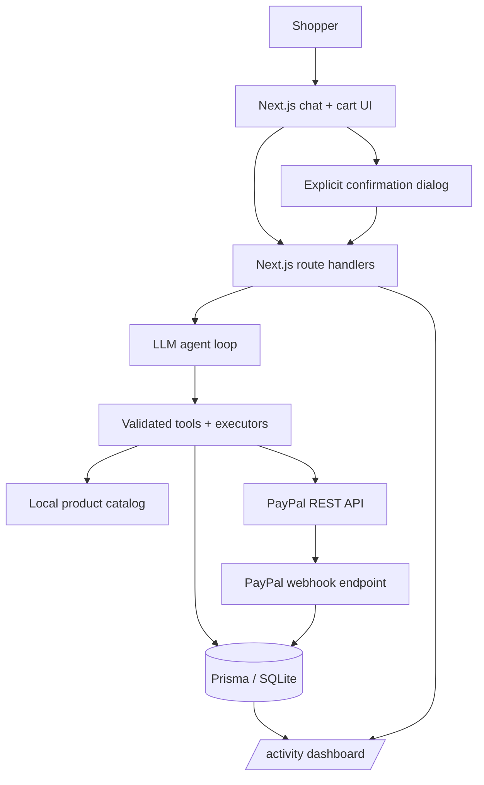

# PayPilot — a chat-first commerce agent with human-approved payments

PayPilot is a demo shopping assistant that lets a shopper discover products, build a cart, check out with PayPal, prepare invoices, request refunds, and inspect an auditable order timeline through a conversational interface.

**Payment safety is the central design rule:** the AI agent can prepare a payment, invoice, or refund, but it cannot execute that action on its own. A separate confirmation dialog requires an explicit user decision before the server calls the money-moving PayPal endpoint. PayPal is configured for **sandbox/test mode** by default; this project is not a production payment platform.

## What it does

- **Conversational product discovery:** the agent searches a local JSON catalog and can respect a maximum unit price.
- **Cart management:** add products, inspect line totals, and clear the cart.
- **PayPal Checkout (sandbox):** create an order, let the buyer approve it with PayPal's checkout UI, verify approval server-side, then request explicit confirmation before capture.
- **Invoices:** prepare and send a PayPal invoice after the user confirms the recipient and invoice details.
- **Refunds:** look up the recorded capture, calculate the remaining refundable amount, and require confirmation before refunding. The server rechecks the amount at execution time.
- **Order explanations:** answer from recorded order events and webhook records. If a reason was not recorded, the assistant is instructed to say so rather than guess.
- **Webhook verification:** verify PayPal signatures, record verified/rejected events, and handle supported capture, refund, and invoice-paid events idempotently.
- **Activity dashboard:** inspect agent tool calls, PayPal API results, debug IDs, request IDs, and webhook verification outcomes at `/activity`.
- **Demo data:** seed a sample cart without needing to manually add products.

## Architecture



### Payment lifecycle

1. The agent creates a PayPal order only after the shopper asks to check out.
2. The shopper approves the order using the PayPal buttons.
3. The server checks the approval with PayPal and records the approved state.
4. The agent can request capture, but this opens a confirmation dialog; it does not capture funds.
5. Only the explicit confirmation endpoint can execute capture. The server reloads the order from the database and uses a stable `PayPal-Request-Id` for idempotency.
6. Verified webhooks reconcile PayPal events and the activity page records the result.

Invoice and refund operations follow the same prepare → review → confirm pattern. Refund amounts are checked against the captured amount minus prior refunds.

## Tech stack

- Next.js 14 App Router, React 18, TypeScript
- Tailwind CSS
- Prisma ORM with SQLite
- PayPal REST APIs and `@paypal/react-paypal-js`
- LLM adapter supporting OpenAI-compatible APIs (including compatible providers such as Gemini) and Anthropic
- Zod tool-input validation
- Vitest

## Run locally

### Requirements

- Node.js 20 or later
- npm
- PayPal sandbox app credentials for checkout/invoice/refund flows
- An API key for one supported LLM provider for chat functionality

### 1. Install

```bash
git clone https://github.com/OmkarMishra56/Paypilot
cd paypilot
npm ci
```

### 2. Configure environment variables

```bash
cp .env.example .env
```

Fill in `.env` locally. Never commit it.

| Variable | Required | Purpose |
|---|---:|---|
| `DATABASE_URL` | Yes | Prisma SQLite URL; local default is `file:./dev.db` |
| `PAYPAL_CLIENT_ID` | For PayPal | Server-side PayPal sandbox client ID |
| `PAYPAL_CLIENT_SECRET` | For PayPal | Server-side PayPal sandbox secret |
| `NEXT_PUBLIC_PAYPAL_CLIENT_ID` | For checkout UI | Same sandbox client ID; intentionally public |
| `PAYPAL_WEBHOOK_ID` | For webhooks | Webhook ID from the PayPal developer dashboard |
| `PAYPAL_BASE` | No | Defaults to PayPal sandbox API URL |
| `LLM_PROVIDER` | No | `openai` or `anthropic`; inferred from configured key if omitted |
| `OPENAI_API_KEY` | For OpenAI-compatible LLM | API key for the selected OpenAI-compatible provider |
| `OPENAI_BASE_URL` | No | Optional base URL for an OpenAI-compatible provider |
| `OPENAI_MODEL` | No | Defaults to `gpt-4o-mini` |
| `ANTHROPIC_API_KEY` | For Anthropic | Anthropic API key when `LLM_PROVIDER=anthropic` |

For Gemini through its OpenAI-compatible endpoint, configure `LLM_PROVIDER=openai`, `OPENAI_API_KEY`, `OPENAI_BASE_URL`, and `OPENAI_MODEL` with values from your provider account. Do not copy credentials into source code or screenshots.

### 3. Prepare the database and run

```bash
npx prisma db push
npm run dev
```

Open <http://localhost:3000>. The health endpoint is <http://localhost:3000/api/health> and the activity dashboard is <http://localhost:3000/activity>.

### 4. Seed a demo cart (optional)

In a second terminal:

```bash
npm run seed:demo
```

Then open <http://localhost:3000/?session=demo-session>.

### 5. Run checks

```bash
npm test
npm run typecheck
npm run build
```

Optional PayPal credential smoke test:

```bash
npm run smoke:paypal
```

This creates a **sandbox** order. It does not capture it. Use only PayPal sandbox buyer credentials to approve test orders.

## PayPal webhook setup

1. Run the app locally and expose it with a trusted HTTPS tunnel during development, or deploy it first.
2. In the PayPal Developer Dashboard, create a webhook pointing to `https://<your-host>/api/paypal/webhook`.
3. Subscribe to the events the current handler supports:
   - `PAYMENT.CAPTURE.COMPLETED`
   - `PAYMENT.CAPTURE.REFUNDED`
   - `INVOICING.INVOICE.PAID`
4. Copy the webhook ID into `PAYPAL_WEBHOOK_ID` in the server environment and restart/redeploy.
5. Trigger sandbox events and check `/activity` for signature verification and processing results.

The webhook route verifies the signature with PayPal before processing an event. An unverified event is not applied to an order.

## Deploy to Render

This repository includes `render.yaml` for a single-instance Render deployment with a persistent disk for SQLite.

1. Push this repository to GitHub.
2. In Render, choose **New → Blueprint** and select the repository.
3. Review the `paypilot` service and create it. The blueprint provisions a persistent disk mounted at `/var/data`.
4. In the Render service environment, set the PayPal sandbox credentials, webhook ID, public PayPal client ID, and LLM key. The blueprint marks secrets as dashboard-managed values.
5. Wait for the deployment and verify `/api/health` returns `{"status":"ok","database":"ok"}`.
6. Configure the PayPal webhook URL using the deployed host as described above.

The Render start command runs `prisma db push` against the persistent SQLite file before starting Next.js. The persistent disk is important: without it, a redeploy or instance replacement can discard the SQLite database. A disk-backed SQLite deployment is suitable for a small demo, not horizontal scaling. For a multi-instance production service, migrate to a managed database such as PostgreSQL and add authentication, authorization, rate limiting, monitoring, and operational controls first.

## Repository layout

```text
app/                 Next.js pages and API routes
  activity/          Tool/API/webhook activity dashboard
  api/               Chat, cart, confirmation, orders, events, webhooks, health
components/          Chat, cart, PayPal checkout, confirmation UI
lib/                 Agent, tools, executors, PayPal, Prisma, order logic
prisma/              Prisma schema
scripts/             Demo seed and PayPal sandbox smoke test
data/                Local demo product catalog
docs/                Submission and operations notes
tests/               Vitest unit tests
render.yaml          Render Blueprint deployment
```

## Safety and limitations

- **Sandbox only by default.** Do not switch this demo to live PayPal credentials without a separate security and compliance review.
- **Human approval required.** Capture, invoice send, and refund are gated by a one-time, expiring confirmation token and a server-side state check.
- **No fabricated order explanations.** Explanations use persisted events and webhook records; missing facts should remain explicitly unknown.
- **Demo catalog.** Products and prices come from `data/products.json`; there is no live inventory or shipping integration.
- **No user account system.** The browser-generated session ID is a demo session boundary, not authentication. Do not use this as-is for real customer accounts or sensitive production data.
- **SQLite deployment constraint.** The included Render configuration is single-instance with a persistent disk. It is not a horizontally scalable production architecture.
- **External testing still required.** Unit tests cannot replace end-to-end testing with PayPal sandbox buyer/seller accounts and real webhook delivery.

## Project notes

See [`docs/SUBMISSION.md`](docs/SUBMISSION.md) for a short reviewer walkthrough and [`docs/OPERATIONS.md`](docs/OPERATIONS.md) for deployment and demo checks.
